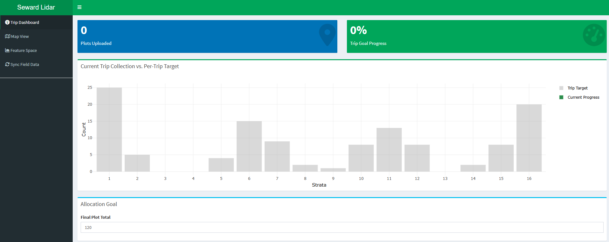
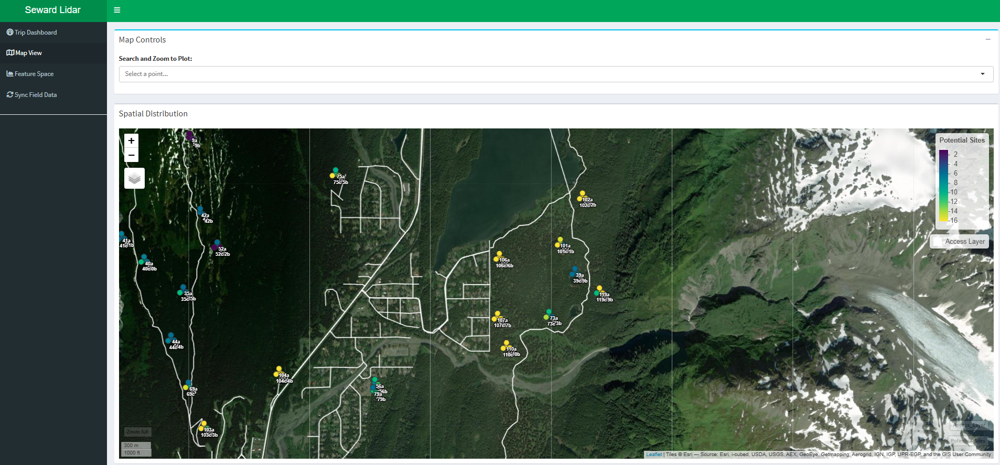
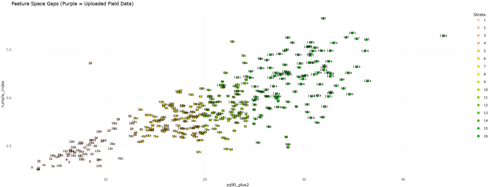
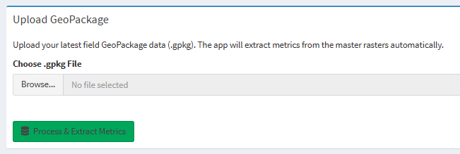

# Seward LiDAR Sampling & Monitoring Dashboard

An R Shiny application designed for forest inventory plot collection planning, real-time field monitoring, and structural representation analysis. This tool complements the `sgsR_SitePlacement.R` site allocation strategy, helping field crews and project managers track sampling progress across environmental strata and feature spaces.

> **Note on Example Data**: This repository includes sample data based on a recent lidar acquisition around **Seward, Alaska**. All data paths and configuration variables in the script are designed to be easily customized so users can point the dashboard to their own regional datasets and lidar metrics.

## Overview & Methodology

### 1. Site Placement (`sgsR_SitePlacement.R`)

Potential sampling locations are generated across the Area of Interest (AOI) along accessible roads and trails using stratified lidar grid metrics:

* **`zq90_plus2`**: The 90th percentile height of lidar returns above 2 meters.
* **`rumple_index`**: Canopy surface roughness calculated using all returns.

#### Strata Construction

* Each metric is split into 4 quantiles, creating a **16-stratum grid** across the forest structure gradient.
* Sites are allocated proportionally using `STRATA_PROPORTIONS`, ensuring target distribution directly mirrors the percentage of forested area occupied by each stratum.
* **Cluster Plot Design**: For each primary point selected, **3 additional sub-plots** are generated nearby. This design provides field crews with local options during sampling, minimizing long travel distances between locations.

## Key Dashboard Features

### 1. Trip Dashboard (`Trip Dashboard`)



* **Progress Tracking**: Compare uploaded field data against allocation goals per stratum.
* **Dynamic Target Adjustment**: Adjust the **Final Plot Total** slider/input; the app recalculates per-stratum goals using constrained integer apportionment (ensuring low-frequency strata meet minimum sampling counts).
* **Summary Metrics**: High-level value boxes displaying total uploaded plots and overall percentage progress toward sampling goals.

### 2. Spatial Map View (`Map View`)



* **Interactive Mapping**: Leaflet and MapView integration showing base layers, potential sites, road/trail access routes, and static plot labels.
* **Collected Field Layer**: Overlays uploaded field observations (`.gpkg`) in real time alongside planned locations.
* **Search & Zoom**: Dynamic dropdown to search and zoom directly to specific plot IDs on the map.

### 3. Feature Space Analysis (`Feature Space`)



* **2D Metric Scatter Plot**: Displays potential and sampled plots along the structural axes (`zq90_plus2` vs `rumple_index`).
* **Gap Identification**: Visualize whether collected plots adequately cover the landscape's structural range or leave gaps in specific strata.
* **Novelty Scoring & Prioritization**: Automatically calculates a Euclidean distance-based novelty rank for unsampled clusters relative to collected plots.
* **Interactive Filtering**: Filter and highlight specific Cluster IDs to inspect sub-plot arrangements within structural space.

### 4. Field Data Sync (`Sync Field Data`)



* **GeoPackage Upload**: Import `.gpkg` files collected in the field.
* **On-the-Fly Raster Extraction**: Automatically extracts structural metrics (`mraster`) and stratum classifications (`sraster`) for newly uploaded coordinates and updates all dashboard analytics instantly.

## Required Data Structure & Customization

The application expects input data located within a `data/` subdirectory relative to the script:

```text
.
├── Seward_Lidar_Sampling_Dashboard_rShiny.R
└── data/
    ├── Seward_SamplingPts.gdb                     # Geodatabase containing potential points
    ├── KenaiVegMap_Roads_Trails_Dataset.gdb       # Access layer geodatabase
    ├── Seward_sraster_16_strata_zq90plus2_rumple.tif  # Strata classification raster
    └── Seward_mraster_zq90plus2_rumple.tif        # Master Lidar metric raster
```

### Adapting to Your Own Acquisition

To use this dashboard for a new project or region, open `Seward_Lidar_Sampling_Dashboard_rShiny.R` and modify the **CONFIGURATION** section at the top of the file:

```R
# --- CONFIGURATION ---
ROOT_DIR <- "data"
POTENTIAL_GDB <- file.path(ROOT_DIR, "Your_SamplingPts.gdb")
POTENTIAL_LAYER <- "Your_SamplingPts_Layer"

ACCESS_GDB <- file.path(ROOT_DIR, "Your_Roads_Trails.gdb")
ACCESS_LAYER <- "Your_Roads_Layer"

SRASTER_PATH <- file.path(ROOT_DIR, "Your_Strata_Raster.tif")
MRASTER_PATH <- file.path(ROOT_DIR, "Your_Lidar_Metrics_Raster.tif")

# Update target defaults and strata proportions to match your study area
DEFAULT_FINAL_PLOT_TOTAL <- 120L
STRATA_PROPORTIONS <- c(...) # Vector of 16 proportions summing to 1.0
```

## Installation & Dependencies

The application automatically checks for and installs missing dependencies upon launch.

### Required Packages

* **GUI & Visualization**: `shiny`, `shinydashboard`, `ggplot2`, `plotly`, `DT`
* **Spatial Processing**: `sf`, `terra`, `leaflet`, `mapview`, `sgsR`
* **Data Handling**: `dplyr`, `rlang`, `shinyFiles`

### Running the App

Open `Seward_Lidar_Sampling_Dashboard_rShiny.R` in RStudio or run it via the command line:

```R
shiny::runApp("Seward_Lidar_Sampling_Dashboard_rShiny.R")
```

## Workflow Summary

1. **Pre-Field Planning**: Review spatial distribution in **Map View** and inspect feature space coverage in **Feature Space**.
2. **Field Operations**: Field crews navigate to target cluster plots located along access routes.
3. **Data Ingestion**: Upload collected GeoPackage (`.gpkg`) files via **Sync Field Data**.
4. **Monitoring & Strategy**: Review the **Trip Dashboard** to check progress per stratum and identify novelty-ranked candidate sites for subsequent field trips.
